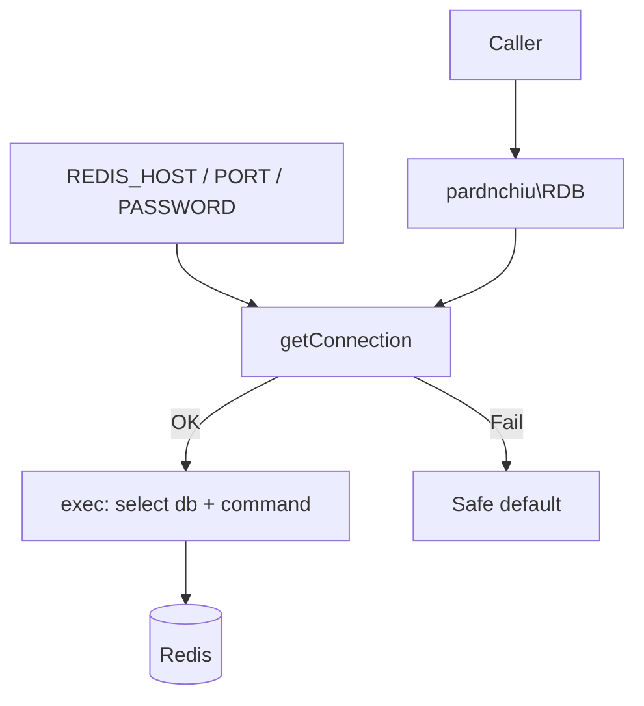

Last updated: 2026-10-25

> [!NOTE]
> This README was generated by [SKILL](https://github.com/agenvoy/skill-readme-generate), get the ZH version from [here](./doc/README.zh.md).

---

<strong>REDIS DOWN? YOUR APP KEEPS RUNNING!</strong>

---

> A PHP Redis client with persistent connections, per-call database selection, and failure-safe default returns

## Table of Contents

- [Features](#features)
- [Architecture](#architecture)
- [License](#license)
- [Author](#author)

## Features

> `composer require pardnchiu/redis-cli` · [Documentation](./doc/doc.md)

- **Connection Failures Never Crash** — Connect or auth failures only reach error_log, and every method returns a safe default such as false, an empty array, or 0 so callers can degrade.
- **Persistent Connections, Lazy Reconnect** — pconnect reuses connections to cut handshake cost, and after a failed first connect every call tries to connect again.
- **Per-Call Database Selection** — The first argument of every method is the DB index, so one instance works across multiple logical databases.
- **TTL on Write** — Write methods for strings, hashes, lists, and sets accept an expiry in seconds, removing the extra EXPIRE call.
- **Common Data Types Covered** — Strings, counters, hashes, lists, set algebra, and batch reads and writes share one consistent method signature.

## Architecture

> [Full Architecture](./doc/architecture.md)

## License

This project is licensed under the [MIT LICENSE](LICENSE).

## Author

Just [open an issue](https://github.com/pardnio/php-redis-cli/issues/new) to share an idea.

---

©️ 2024 [邱敬幃 Pardn Chiu](https://www.linkedin.com/in/pardnchiu)
