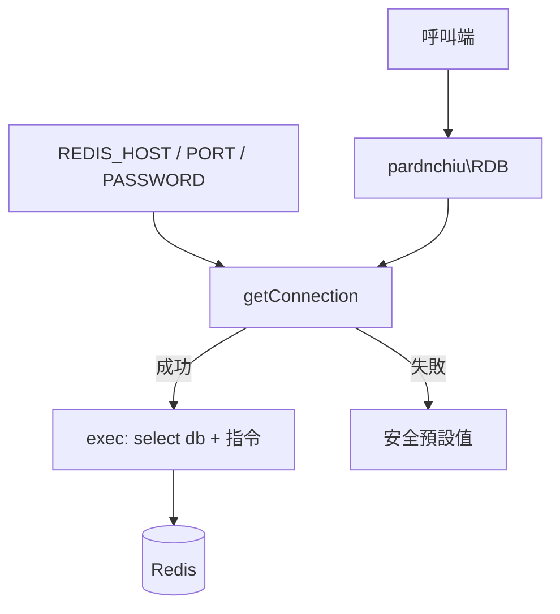

最後更新：2026-10-25

> [!NOTE]
> 此 README 由 [SKILL](https://github.com/agenvoy/skill-readme-generate) 生成，英文版請參閱 [這裡](../README.md)。

---

<strong>REDIS DOWN? YOUR APP KEEPS RUNNING!</strong>

---

> PHP Redis 客戶端，具備持久連線、逐次指定資料庫與連線失敗安全預設值

## 目錄

- [功能特點](#功能特點)
- [架構](#架構)
- [授權](#授權)
- [Author](#author)

## 功能特點

> `composer require pardnchiu/redis-cli` · [完整文件](./doc.zh.md)

- **連線失敗不中斷服務** — 連線或認證失敗只寫入 error_log，所有方法改回傳 false、空陣列或 0 等安全預設值，呼叫端可據此降級。
- **持久連線與惰性重連** — 以 pconnect 重用連線降低握手成本，初次連線失敗後每次呼叫都會再嘗試建立連線。
- **逐次指定資料庫** — 每個方法的第一個參數即 DB 編號，單一實例即可操作多個邏輯資料庫。
- **寫入時一併設定 TTL** — 字串、雜湊、清單與集合的寫入方法都能直接帶入過期秒數，免去額外的 EXPIRE 呼叫。
- **常用資料型別全覆蓋** — 字串、計數器、雜湊、清單、集合運算與批次讀寫皆以一致的方法簽章提供。

## 架構

> [完整架構](./architecture.zh.md)

## 授權

本專案採用 [MIT LICENSE](../LICENSE)。

## Author

Just [open an issue](https://github.com/pardnio/php-redis-cli/issues/new) to share an idea.

---

©️ 2024 [邱敬幃 Pardn Chiu](https://www.linkedin.com/in/pardnchiu)
