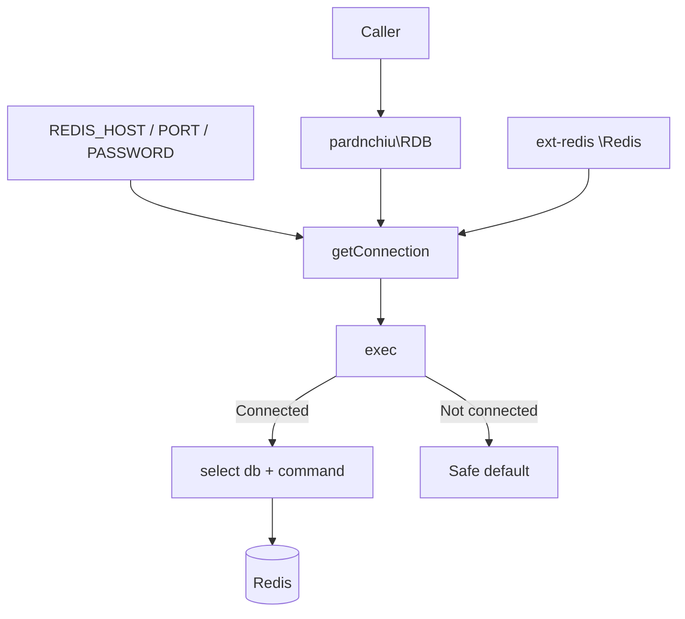
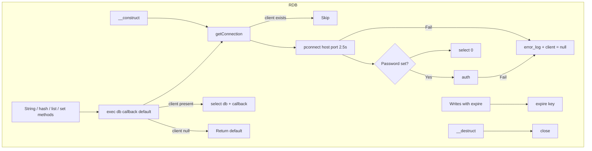
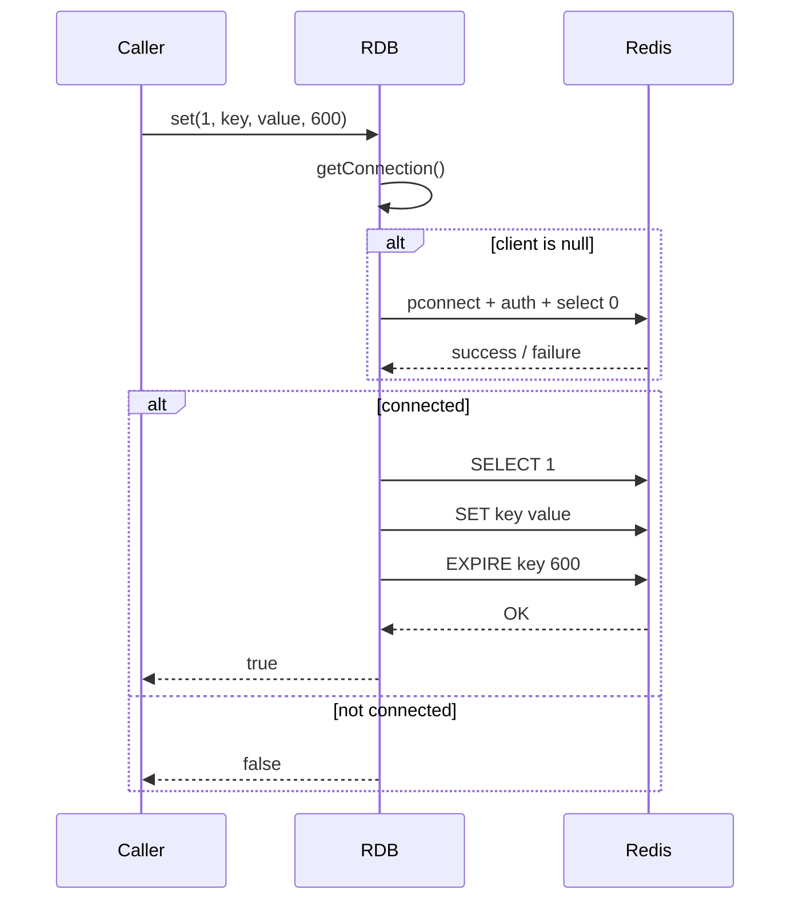
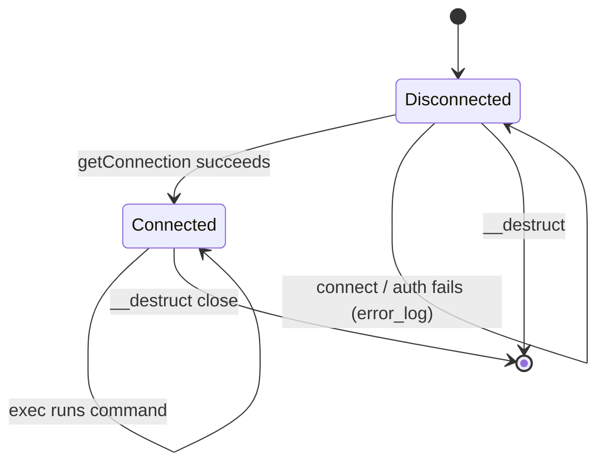

# php-redis-cli - Architecture

Last updated: 2026-10-25

> Back to [README](../README.md)

## Overview

## Module: RDB

Every public method of `pardnchiu\RDB` goes through `exec()`, which ensures a connection and switches the database.

## Data Flow

## State Machine

***

©️ 2024 [邱敬幃 Pardn Chiu](https://www.linkedin.com/in/pardnchiu)
