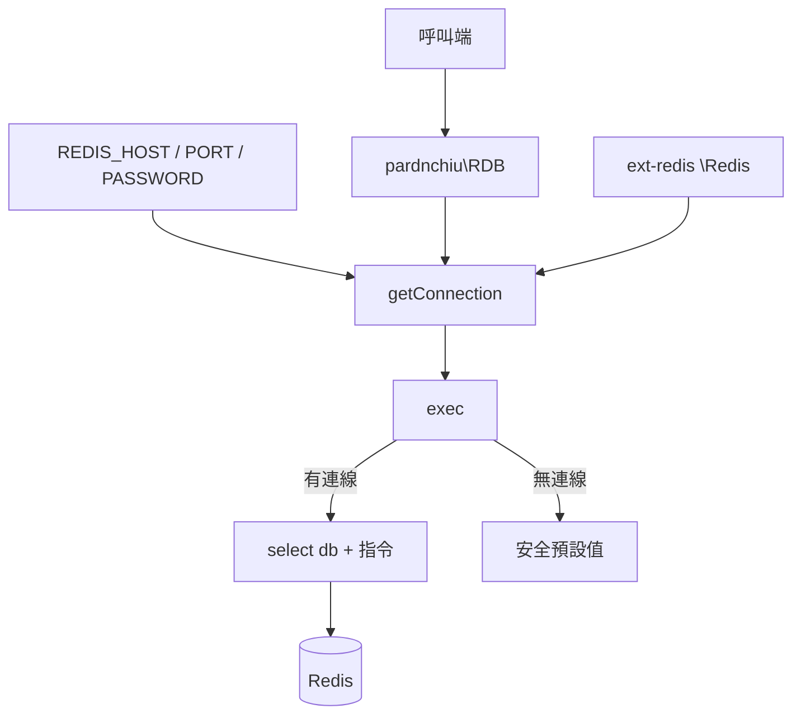
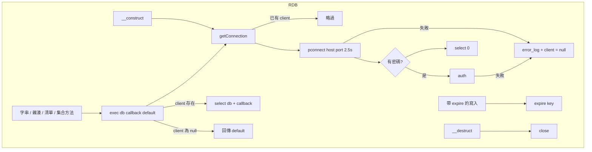
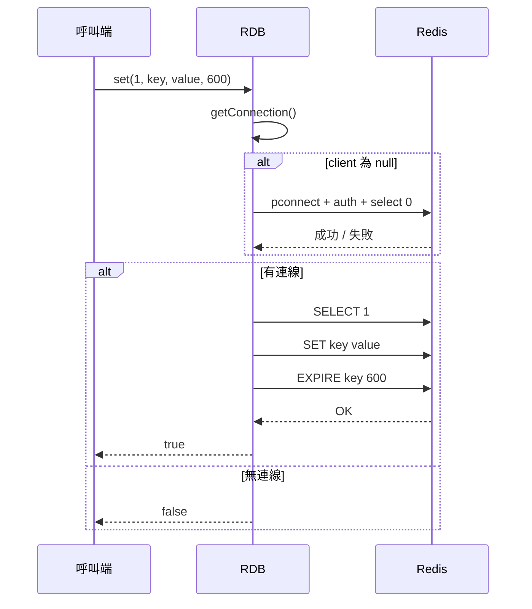
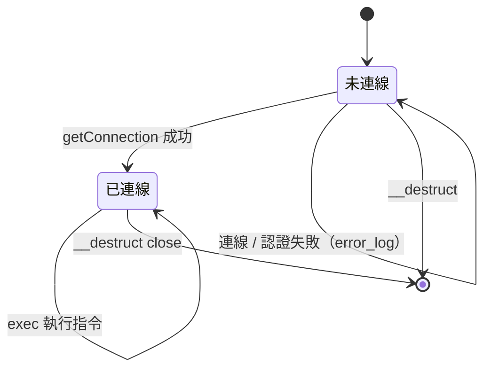

# php-redis-cli - 架構

最後更新：2026-10-25

> 返回 [README](./README.zh.md)

## 概覽

## Module: RDB

`pardnchiu\RDB` 所有公開方法都經過 `exec()`，由它確保連線並切換資料庫。

## Data Flow

## State Machine

***

©️ 2024 [邱敬幃 Pardn Chiu](https://www.linkedin.com/in/pardnchiu)
